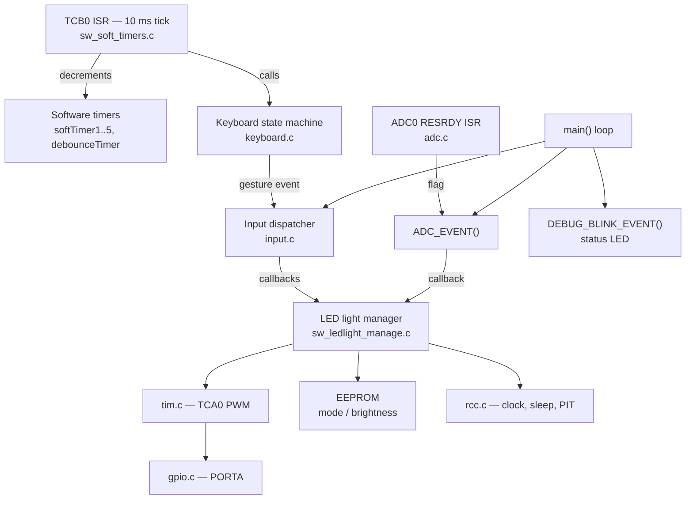

# ATtiny402 LED Driver

Firmware for a compact **single-button LED flashlight driver** built around the
Microchip **ATtiny402** (tinyAVR® 0-series, SOIC-8). The driver controls LED
brightness with hardware PWM, offers several light modes and gamma-corrected
brightness levels selected with one push button, remembers settings in EEPROM,
and is designed to monitor a single-cell Li-ion battery and enter a low-power
state.

The firmware is written in bare-metal C (register level, no Arduino core) and
uses a small set of reusable, STM32-style peripheral wrappers (`gpio`, `tim`,
`adc`, `rcc`) ported to the new AVR 0-series register model.

> **Status:** work in progress. See [Project status / TODO](#project-status--todo).

---

## Table of contents

- [Features](#features)
- [Hardware](#hardware)
- [Pinout](#pinout)
- [User interface](#user-interface)
- [Firmware architecture](#firmware-architecture)
- [MCU resources](#mcu-resources)
- [Repository layout](#repository-layout)
- [Building](#building)
- [Flashing (UPDI)](#flashing-updi)
- [Configuration](#configuration)
- [Project status / TODO](#project-status--todo)

---

## Features

- **Hardware PWM LED control**: TCA0 in single-slope mode, 8-bit resolution
  (~814 Hz at 3.33 MHz). The code supports up to 3 PWM channels, selected at compile time.
- **Two LED channels** (*low-power* and *high-power*) with four modes:
  `LOW`, `HIGH`, `LOW + HIGH` and `ALL OFF`.
- **6 gamma-corrected brightness levels**: `0, 8, 38, 68, 130, 255`
  (0 %, 3 %, 15 %, 27 %, 51 %, 100 % duty).
- **Single-button UI** with gesture recognition: short press, double press,
  medium press, auto-repeat and very long press.
- **Settings stored in EEPROM**: light mode and brightness level, guarded by a validity marker byte.
- **Li-ion battery monitoring**: ADC0 with the internal 2.5 V reference, 4-sample
  hardware accumulation and threshold hysteresis. When the battery is low, the
  LEDs are switched off and locked, and the status LED flashes a warning.
- **Low-power support**: PWM and timer shutdown, button wake-up interrupt, Power-Down
  sleep helper and an RTC/PIT periodic wake-up source.
- **Non-blocking design**: 10 ms system tick, software timers and an event/callback
  dispatcher. The main loop never busy-waits.

## Hardware

The hardware is designed in **KiCad** (schematic, PCB layout and 3D model).

| File | Description |
|------|-------------|
| `hardware/` | KiCad project (`.kicad_pro`, `.kicad_sch`, `.kicad_pcb`) |
| `docs/images/schematic.png` | Schematic export |
| `docs/images/pcb.png` | PCB layout |
| `docs/images/pcb_3d.png` | 3D render of the assembled board |

<!-- Uncomment after adding the images:


-->

Main building blocks (as assumed by the firmware):

- **MCU**: ATtiny402 running from the internal 20 MHz oscillator divided by 6 (3.33 MHz).
- **LED drivers**: logic-level MOSFET switches for the low- and high-power LEDs,
  driven directly by the TCA0 PWM outputs.
- **Push button** to GND, using the internal pull-up.
- **Status LED** on a GPIO for feedback (mode changes, low-battery warning).
- **Battery sense divider**: 68 kΩ / 100 kΩ, which scales 4.2 V to 2.5 V (full
  scale of the internal reference).
- **UPDI header** for programming (PA0, VDD, GND).

## Pinout

ATtiny402, SOIC-8, as currently defined in
[`inc/ATTINY402_led_driver.h`](inc/ATTINY402_led_driver.h) and
[`libs/SW_AVR_PERIPHS/tim_defs.h`](libs/SW_AVR_PERIPHS/tim_defs.h):

| Pin | Port | Function in firmware | Alternative function |
|:---:|:----:|----------------------|----------------------|
| 1 | VDD | Supply (battery) | |
| 2 | PA6 | `LED_LO_POWER_PIN` (defined, not used yet) | TCB0 WO, AIN6 |
| 3 | PA7 | Status LED (`LED_DIAG`) | TCA0 WO0 (alt), AIN7 |
| 4 | PA1 | Push button `KEY1` (active low, pull-up) | TCA0 WO1 → PWM CH2 |
| 5 | PA2 | PWM CH3 (disabled by default) | TCA0 WO2, AIN2 |
| 6 | PA0 | UPDI programming / debug | |
| 7 | PA3 | **PWM CH1** (TCA0 WO0), LED output | AIN3 |
| 8 | GND | Ground | |

## User interface

Everything is controlled with a single button. Gesture timing is configured in
[`keyboard.h`](libs/SW_INPUT/KEYBOARD/keyboard.h) (10 ms resolution).

| Gesture | Timing | Event | Action |
|---------|--------|-------|--------|
| Short click | ≤ 150 ms, no second click within ~170 ms | `SHORT_PRESS` | Next light mode: `LOW → HIGH → LOW+HIGH → …` (ignored while the battery lock is active) |
| Double click | Two short clicks within 200 ms | `DOUBLE_PRESS` | Toggle status LED |
| Medium press | Released after ~500–880 ms | `MEDIUM_PRESS` | Next brightness level (6 levels, wraps around) |
| Hold | > 880 ms, then every 100 ms | `KEY_REPEAT` | Toggle status LED (visual feedback while holding) |
| Very long press | ~2.9 s (20 repeat periods) | `VLONG_PRESS` | Power down: PWM off, timer stopped, button set up as wake-up source |

Callbacks are registered in `LEDLIGHT_init()`, so you can remap a gesture with one line:

```c
INPUT_EVENTS_cb_reg( EVENT_KEY1_SHORT_PRESS,  LEDLIGHT_mode_switch );
INPUT_EVENTS_cb_reg( EVENT_KEY1_MEDIUM_PRESS, LEDLIGHT_more_light  );
INPUT_EVENTS_cb_reg( EVENT_KEY1_VLONG_PRESS,  LEDLIGHT_power_down  );
```

### Battery protection

The battery voltage is measured on the divider (VREF = 2.5 V, 10-bit ADC):

| Battery | Pin voltage | ADC code |
|--------:|------------:|---------:|
| 4.2 V | 2.50 V | 1023 |
| 3.6 V | 2.14 V | 877 |
| 3.4 V | 2.02 V | 828 |
| 3.3 V | 1.96 V | 804 (`ADC_THRESHOLD_MAX`) |
| ~3.2 V | ~1.91 V | 780 (`ADC_THRESHOLD_MIN`) |

- If the reading stays below `ADC_THRESHOLD_MIN` for 10 consecutive conversions,
  the LEDs are switched off and mode changes are locked. The status LED flashes 20 times.
- If the reading stays above `ADC_THRESHOLD_MAX` for 10 consecutive conversions,
  the lock is released and the previous mode is restored.

## Firmware architecture



**Design rules used throughout the code:**

- ISRs stay short. They only set flags or capture data, and the main loop runs the
  callbacks (`INPUT_event_execute()`, `ADC_EVENT()`).
- Shared data is copied inside short critical sections (`SREG` saved and restored).
- Peripheral wrappers keep an STM32-like API (`gpio_pin_cfg`, `gpio_pin_HI/LO/XOR`,
  `GPIO_TypeDef`), so application code can be shared with the author's STM32 projects.
- Interrupt flags are cleared by writing `1` (the AVR 0-series convention), and protected
  clock registers are unlocked with `CPU_CCP = CCP_IOREG_gc`.

## MCU resources

| Resource | Usage |
|----------|-------|
| CLK_MAIN | OSC20M / 6 = 3.33 MHz (`F_CPU = 3333333UL`); 1, 8, 16 and 20 MHz are also handled |
| TCA0 | Single-slope PWM, `PER = 255`, CLK/16, about 814 Hz; also clocks TCB0 |
| TCB0 | Periodic interrupt every 10 ms (`CCMP = 2083`), system tick |
| ADC0 + VREF | 2.5 V internal reference, CLK/32 (~104 kHz), 4-sample accumulation, RESRDY interrupt |
| RTC / PIT | Periodic wake-up helpers (`WDT_enable()` / `WDT_disable()`) |
| SLPCTRL | Power-Down sleep helper (`RCC_sleep_enable()`) |
| EEPROM | 3 bytes: validity marker, brightness index, light mode |
| Flash / RAM | ~2.0 kB / 4 kB flash, ~52 B / 256 B RAM (avr-gcc `-Os`, `--gc-sections`) |

## Repository layout

```
├── Attiny402_led_driver.c      # main(): init + cooperative main loop
├── inc/
│   ├── ATTINY402_led_driver.h  # board pin definitions
│   ├── sw_mcu_conf.h           # common macros (SET_BIT, MODIFY_REG, INLINE…)
│   └── bool.h
├── libs/
│   ├── SW_AVR_PERIPHS/         # gpio, tim (TCA0 PWM), adc (ADC0/VREF), rcc (clock/sleep/PIT)
│   ├── SW_TIMERS/              # 10 ms tick on TCB0 + software timers + millis()
│   ├── SW_INPUT/               # input dispatcher + KEYBOARD gesture state machine
│   ├── SW_LEDLIGHT/            # flashlight logic: modes, brightness, EEPROM, battery
│   └── SW_BOARD/               # status LED / debug blink
├── 00_tmp/                     # scratch files, excluded from the build
├── hardware/                   # KiCad project (to be added)
└── .project, .cproject, .settings/   # Eclipse project files
```

## Building

### Eclipse (recommended)

The project uses **Eclipse CDT** with the **AVR Eclipse Plugin** (`de.innot.avreclipse`)
and was tested with Eclipse 2023-12.

1. *File → Import → Git → Projects from Git → Clone URI* and paste
   `https://github.com/Zealota74/ATtiny402_led_driver.git`.
2. Select *Import existing Eclipse projects*.
3. Build the **Release** configuration. Outputs: `ATtiny402_.elf`, `.hex`, `.eep`, `.lss`.

Include paths are relative to the project (`${ProjDirPath}`), so no path editing is needed.

### Command line (avr-gcc)

ATtiny402 support needs an avr-gcc/avr-libc build that knows the tinyAVR 0-series
(e.g. the toolchain bundled with Microchip Studio / MPLAB), or any avr-gcc together
with the Microchip
[ATtiny_DFP](https://packs.download.microchip.com/) device pack:

```sh
DFP=/path/to/Microchip.ATtiny_DFP
SRCS=$(find . -name '*.c' -not -path './00_tmp/*' -not -path './Release/*')

avr-gcc -B $DFP/gcc/dev/attiny402 -isystem $DFP/include \
  -mmcu=attiny402 -DF_CPU=3333333UL -Os -std=gnu99 -Wall \
  -funsigned-char -funsigned-bitfields -fpack-struct -fshort-enums \
  -ffunction-sections -fdata-sections -Wl,--gc-sections \
  -Iinc -Ilibs -Ilibs/SW_AVR_PERIPHS \
  $SRCS -o ATtiny402_.elf

avr-objcopy -O ihex -R .eeprom -R .fuse -R .lock -R .signature ATtiny402_.elf ATtiny402_.hex
avr-size ATtiny402_.elf
```

## Flashing (UPDI)

The ATtiny402 is programmed over the one-wire **UPDI** interface (PA0). Any of these works:

- **SerialUPDI**: a USB-UART adapter with a ~470 Ω–1 kΩ resistor between TX and RX
  (or a Schottky diode).
  ```sh
  avrdude -c serialupdi -p t402 -P COM3 -U flash:w:ATtiny402_.hex:i
  # or
  pymcuprog write -t uart -u COM3 -d attiny402 -f ATtiny402_.hex --erase --verify
  ```
- **Microchip tools**: MPLAB SNAP, PICkit 4/5, Atmel-ICE, Curiosity Nano (nEDBG).

EEPROM defaults are created by the firmware on first boot, so flashing the `.eep` file is optional.

## Configuration

| Setting | Location | Default |
|---------|----------|---------|
| CPU clock | project settings / `F_CPU` | `3333333UL` |
| Active PWM channels | `USE_PWM_CH1..3` in `tim.h` | CH1 only |
| Board pins | `inc/ATTINY402_led_driver.h` | see [Pinout](#pinout) |
| Gesture timing | `libs/SW_INPUT/KEYBOARD/keyboard.h` | see [User interface](#user-interface) |
| Brightness table | `BrightGamma[]` in `sw_ledlight_manage.c` | `0, 8, 38, 68, 130, 255` |
| Battery thresholds | `ADC_THRESHOLD_MIN/MAX` in `adc.h` | 780 / 804 |

## Project status / TODO

- [ ] Final pin assignment. The board header, the PWM mapping and the ADC input
      currently overlap: PA3 is both PWM CH1 and ADC input AIN3, PA1 is both the button
      and PWM CH2, and `BAT_SENS_PIN = PA4` does not exist on the SOIC-8 package.
- [ ] Enable the second LED channel. `LED_HIGH_POWER` uses PWM CH2, which is disabled
      (`USE_PWM_CH2 = 0`).
- [ ] Enable battery monitoring (`ADC_init()` is commented out in `main()`) and scale the
      thresholds for 4-sample accumulation (`ADC0.RES` holds the sum of 4 samples).
- [ ] Hook up Power-Down sleep, wake-up (`RCC_sleep_enable()`, `LEDLIGHT_wakeup()`) and
      a PORTA wake-up ISR.
- [ ] Call `EEPROM_update()` when settings change.
- [ ] Add the KiCad project and images to `hardware/` and `docs/images/`.
- [ ] Choose a license.
